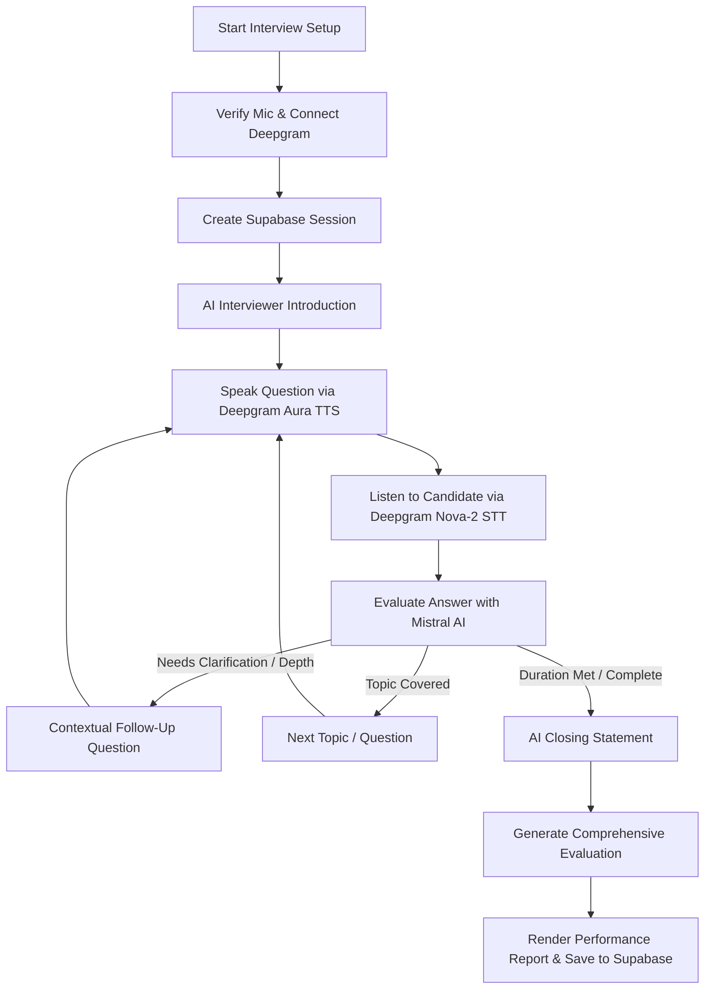

# PrepPilot AI — Autonomous AI Mock Interview & Technical Placement Platform

[](https://nextjs.org/)
[](https://mistral.ai/)
[](https://deepgram.com/)
[](https://supabase.com/)
[](https://tailwindcss.com/)

**PrepPilot AI** is an end-to-end, voice-enabled, autonomous mock interview and placement readiness platform. It features an intelligent AI Interview Agent powered by **Mistral AI** for multi-topic interview reasoning and evaluation, paired with **Deepgram Nova-2** and **Deepgram Aura** for natural voice interactions.

---

## 📑 Table of Contents

- [Key Features](#-key-features)
- [System Architecture](#-system-architecture)
- [Project Structure](#-project-structure)
- [Tech Stack](#-tech-stack)
- [Environment Variables](#-environment-variables)
- [Getting Started](#-getting-started)
  - [Prerequisites](#prerequisites)
  - [1. Clone Repository](#1-clone-repository)
  - [2. Environment Configuration](#2-environment-configuration)
  - [3. Frontend Setup](#3-frontend-setup)
  - [4. Backend Setup (Optional FastAPI Engine)](#4-backend-setup-optional-fastapi-engine)
  - [5. Supabase Database Setup](#5-supabase-database-setup)
- [Interview Agent Workflow](#-interview-agent-workflow)
- [Available Scripts](#-available-scripts)
- [Troubleshooting & FAQs](#-troubleshooting--faqs)
- [License](#-license)

---

## 🚀 Key Features

### 1. Human-Like AI Mock Interview Agent
- **Multiple Interview Tracks**:
  - **Technical Interview**: System architecture, API design, algorithms, concurrency, and debugging.
  - **HR Interview**: Cultural fit, leadership, career aspirations, and team collaboration.
  - **Behavioral Interview**: Structured STAR-format scenarios, resilience, and crisis management.
  - **Mixed Interview**: Comprehensive 5-round simulation combining HR, Technical, and Behavioral assessments.
- **Dynamic Configuration**: Customize target job role, experience level (*Fresher*, *Intermediate*, *Experienced*), duration (*10, 15, 20, or 30 mins*), language (*English* or *Hindi*), and optional Job Description.

### 2. Real-Time Conversational Voice
- **Deepgram Speech-to-Text (STT)**: Nova-2 model with smart endpointing and real-time silence detection.
- **Deepgram Text-to-Speech (TTS)**: High-fidelity `aura-asteria-en` voice with synced typewriter subtitles.
- **Audio Overlap & Echo Protection**: Automatically mutes microphone capture during AI speech playback to eliminate feedback loops.

### 3. State Machine & Topic Progression
- **Agent Lifecycle**: `IDLE` → `SETUP` → `INTRODUCTION` → `ASKING` → `LISTENING` → `TRANSCRIBING` → `EVALUATING` → `FOLLOW_UP / NEXT_QUESTION` → `CLOSING` → `COMPLETED`.
- **Intelligent Follow-ups**: Evaluates answers on depth and clarity. Caps follow-ups to 1–2 per topic before automatically advancing.
- **Silence & Clarification Handling**: If an answer is unclear or too short, offers one prompt to elaborate before smoothly moving on.

### 4. Objective Post-Interview Performance Report
- **Multi-Dimensional Scoring (0–100)**: Overall Score, Technical Knowledge, Communication, Problem Solving, and Confidence.
- **Detailed Feedback**: Itemized question-by-question breakdown, constructive critique, identified strengths, and recommended practice topics.
- **Interview History**: Stores past sessions in Supabase for progress tracking over time.

---

## 🏛 System Architecture

```text
[ Browser / Client ]
       │
       ├── User Voice Input (Microphone) ─────────► [ /api/interviews/stt (Deepgram Nova-2) ]
       │                                                         │
       │◄── Text-to-Speech Audio ───────────────── [ /api/interviews/tts (Deepgram Aura) ]
       │
       ├── Agent Reasoning & Decisions ──────────► [ /api/interviews/chat (Mistral AI) ]
       │                                                         │
       ├── Final Evaluation & Scoring ───────────► [ /api/interviews/evaluate (Mistral AI) ]
       │
       └── Session & Message Persistence ────────► [ Supabase (PostgreSQL + RLS) ]
```

---

## 📂 Project Structure

```text
social-impact-hackathon-project/
├── frontend/                     # Next.js 14 App Router application
│   ├── app/
│   │   ├── (auth)/               # Login & Register views
│   │   ├── (dashboard)/
│   │   │   ├── interview/        # AI Interview Arena & History UI
│   │   │   ├── assessments/      # Adaptive assessments & exam engine
│   │   │   └── dashboard/        # Main student overview
│   │   └── api/
│   │       └── interviews/
│   │           ├── chat/         # Mistral AI Interview Agent orchestration
│   │           ├── evaluate/     # Mistral AI Post-Interview Evaluation
│   │           ├── stt/          # Deepgram Nova-2 STT proxy
│   │           ├── tts/          # Deepgram Aura TTS proxy
│   │           └── deepgram-token/ # Client token verification
│   ├── components/               # JarvisOrb, Navbar, Layouts, UI widgets
│   ├── context/                  # AuthContext, InterviewSessionContext
│   └── lib/                      # Supabase client & utilities
├── backend/                      # Optional FastAPI multi-agent backend
│   ├── app/                      # Agents, routing, core logic
│   └── requirements.txt          # Python dependencies
├── docs/
│   └── schema.sql                # Supabase database table definitions & RLS
├── .env.example                  # Root environment template
└── README.md                     # Documentation
```

---

## 🛠 Tech Stack

| Layer | Technologies |
| :--- | :--- |
| **Frontend** | [Next.js 14](https://nextjs.org/) (App Router), [React 18](https://react.dev/), [TypeScript](https://www.typescriptlang.org/) |
| **Styling** | [Tailwind CSS](https://tailwindcss.com/), [Framer Motion](https://www.framer.com/motion), [Lucide React Icons](https://lucide.dev/) |
| **AI Reasoning** | [Mistral AI API](https://mistral.ai/) (`mistral-small-latest` with JSON mode) |
| **Voice / Speech** | [Deepgram Nova-2](https://deepgram.com/) (STT) & [Deepgram Aura](https://deepgram.com/) (TTS) |
| **Database & Auth** | [Supabase](https://supabase.com/) (PostgreSQL with Row Level Security) |
| **HTTP Client** | [Axios](https://axios-http.com/) & Native Fetch API |

---

## 🔑 Environment Variables

Create a `.env` file in the project root and in `frontend/.env.local`:

```env
# ==============================================================================
# Mistral AI Configuration
# ==============================================================================
MISTRAL_API_KEY=your_mistral_api_key_here
MISTRAL_MODEL=mistral-small-latest
MISTRAL_API_URL=https://api.mistral.ai/v1/chat/completions

# ==============================================================================
# Deepgram Voice AI Configuration
# ==============================================================================
DEEPGRAM_API_KEY=your_deepgram_api_key_here

# ==============================================================================
# Supabase Configuration
# ==============================================================================
NEXT_PUBLIC_SUPABASE_URL=https://your-project.supabase.co
NEXT_PUBLIC_SUPABASE_ANON_KEY=your_supabase_anon_key_here
SUPABASE_SERVICE_ROLE_KEY=your_supabase_service_role_key_here

# ==============================================================================
# Application Configuration
# ==============================================================================
NEXT_PUBLIC_APP_URL=http://localhost:3000
```

> **Security Note:** Never commit `.env` or `.env.local` to source control. Secret API keys (`MISTRAL_API_KEY`, `DEEPGRAM_API_KEY`) are accessed strictly on the server-side via Next.js route handlers.

---

## 🏁 Getting Started

### Prerequisites
- **Node.js**: v18.17.0 or higher
- **npm**: v9.0.0 or higher
- **Supabase Account**: A free project with PostgreSQL database
- **Mistral AI Account**: For API key access
- **Deepgram Account**: For Speech-to-Text & Text-to-Speech API access

---

### 1. Clone Repository

```bash
git clone https://github.com/your-username/preppilot-ai.git
cd preppilot-ai
```

---

### 2. Environment Configuration

Copy the example environment template:

```bash
cp .env.example .env
cp .env.example frontend/.env.local
```

Fill in your `MISTRAL_API_KEY`, `DEEPGRAM_API_KEY`, and `NEXT_PUBLIC_SUPABASE_*` credentials.

---

### 3. Frontend Setup

```bash
cd frontend
npm install
npm run dev
```

Open [http://localhost:3000](http://localhost:3000) in your browser.

---

### 4. Deploying Frontend to Vercel

To deploy the **PrepPilot AI** Next.js frontend to Vercel:

1. Go to [Vercel Dashboard](https://vercel.com/new).
2. Import your GitHub repository: `https://github.com/soham10667/social-impact-hackathon`.
3. Configure the Project Settings:
   - **Project Name**: `social-impact-frontend`
   - **Framework Preset**: `Next.js`
   - **Root Directory**: Click *Edit* and select `frontend`
   - **Build Command**: `npm run build` (or leave default)
   - **Output Directory**: `.next` (leave default)
   - **Install Command**: `npm install` (leave default)
4. Add the following **Environment Variables** in Vercel:
   ```env
   NEXT_PUBLIC_API_URL=https://social-impact-hackathon.vercel.app
   NEXT_PUBLIC_SUPABASE_URL=https://your-project.supabase.co
   NEXT_PUBLIC_SUPABASE_ANON_KEY=your_supabase_anon_key_here
   MISTRAL_API_KEY=your_api_key_here
   DEEPGRAM_API_KEY=your_deepgram_api_key_here
   ONECOMPILER_API_KEY=your_onecompiler_api_key_here
   ```
5. Click **Deploy**. Your frontend will be live on `https://social-impact-frontend.vercel.app`!

If utilizing the auxiliary Python FastAPI agents:

```bash
cd backend
python -m venv venv

# Windows
.\venv\Scripts\activate

# macOS / Linux
source venv/bin/activate

pip install -r requirements.txt
uvicorn app.main:app --reload --port 8000
```

---

### 5. Supabase Database Setup

Run the SQL script located in [`docs/schema.sql`](file:///e:/social%20impact%20hackathon%20project/docs/schema.sql) in your Supabase SQL Editor to initialize the necessary tables and Row Level Security (RLS) policies:

- `interview_sessions`: Stores interview configurations, duration, difficulty, and status.
- `interview_messages`: Stores dialogue turns between the AI interviewer and the candidate.
- `interview_evaluations`: Stores performance scores, strengths, improvement areas, and breakdown.

---

## 🔄 Interview Agent Workflow



---

## 📋 Available Scripts

Inside the `frontend/` directory:

| Command | Description |
| :--- | :--- |
| `npm run dev` | Starts the Next.js development server on `http://localhost:3000` |
| `npm run build` | Builds the optimized production application |
| `npm run start` | Runs the compiled production server |
| `npm run lint` | Runs ESLint to check for code quality and syntax issues |

---

## ❓ Troubleshooting & FAQs

#### 1. Microphone permission denied?
- Ensure microphone permissions are allowed in browser settings for `http://localhost:3000`.
- The interview UI displays a clear notification banner with instructions if microphone access is blocked.

#### 2. Deepgram voice not playing?
- Modern browsers require user interaction before playing audio automatically. Clicking the **"Start Voice Interview"** button initiates user gesture authorization so audio plays seamlessly.
- If no Deepgram key is present, the app automatically falls back to browser-native `SpeechSynthesis`.

#### 3. Mistral API rate limit or error?
- Check your balance and quota in the Mistral AI console.
- In the event of API unavailability, the agent utilizes a calibrated deterministic fallback interview track so the session never crashes.

---

## 📄 License

This project is licensed under the **MIT License**. Feel free to use, modify, and distribute with attribution.
